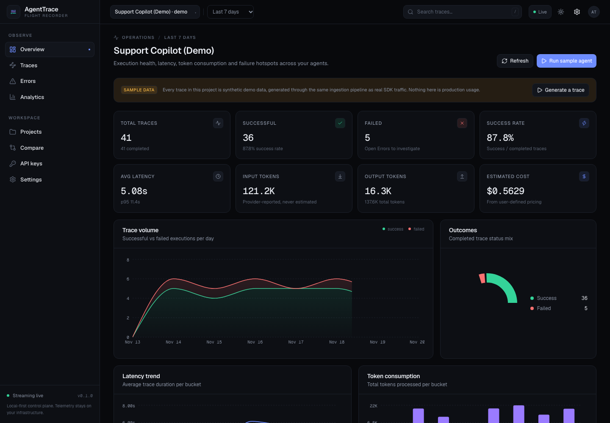
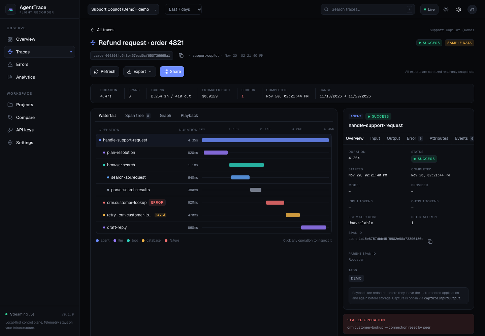
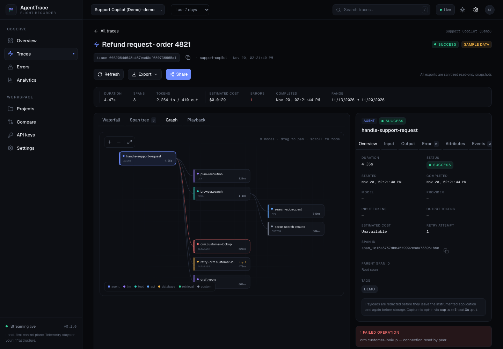
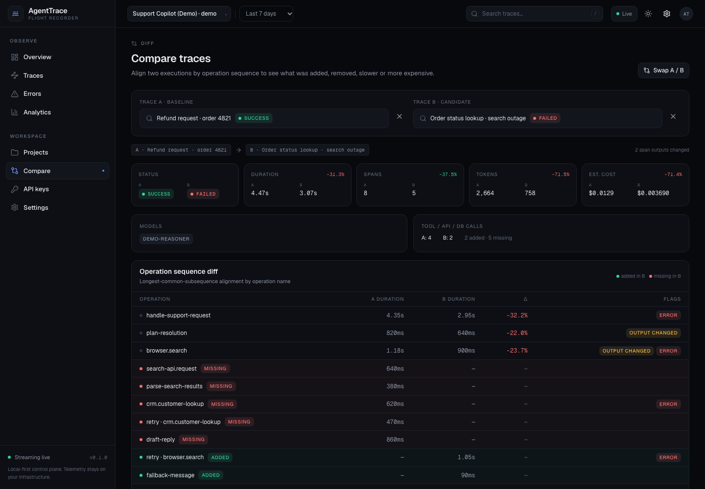
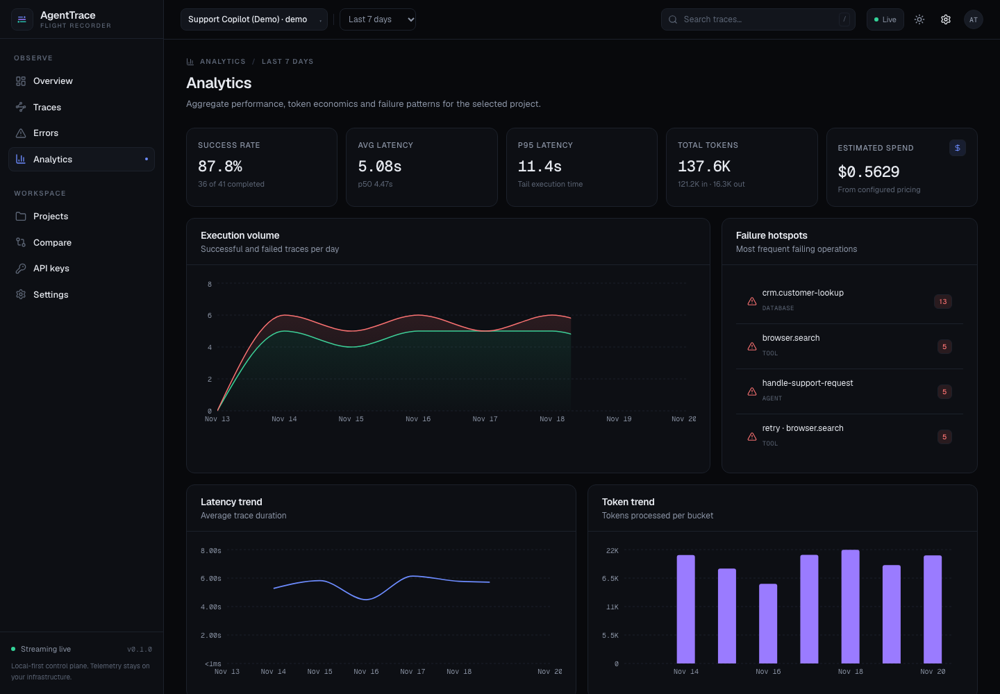

# AgentTrace

**The flight recorder for AI agents.** Open-source, local-first distributed tracing, live execution
monitoring, token economics and failure analysis for AI agents.

`MIT` · `Developer preview 0.1.0` · `Node.js 20.11+` · `PostgreSQL 14+` · `No Docker required`



AgentTrace records what your agent actually did: every model call, tool invocation, database lookup,
retrieval step and retry. It then turns that execution into a trace you can inspect, compare, share
and export. Telemetry stays in your own PostgreSQL database.

## What you get

- **One SDK, any provider.** Instrument OpenAI, Anthropic, Bedrock, a local model or a hand-written
  agent loop. Nested spans use `AsyncLocalStorage`; no framework lock-in.
- **Trace explorer.** Search, filter and sort by status, agent, model, tool, duration and time range.
- **Deep inspection.** Waterfall timing, parent-child hierarchy, an interactive execution graph,
  safe read-only playback, payload inspector, attributes, events and error details.
- **Live monitoring.** Project-isolated WebSockets update the dashboard as traces and spans arrive.
- **Token and cost tracking.** Provider-reported usage only. Cost is shown only when *you* configure
  model pricing; otherwise it is explicitly unavailable.
- **Error analytics.** Group repeated failures by operation, type and message, then jump to a sample
  trace.
- **Trace comparison.** Align two executions by operation sequence and see added, removed, slower,
  changed or more expensive steps.
- **Sanitized exports and deliberate sharing.** JSON, Markdown and print-friendly HTML; read-only
  share links with expiry, revocation and a sensitive-trace guard.
- **Honest demo data.** Seven synthetic scenarios are ingested through the real pipeline and clearly
  labelled as sample data.
- **Local-first security.** Admin token stays server-side; API keys and share tokens are hashed;
  input/output capture is off by default.

## Screenshots

All images are captured from the running application with Playwright, not mocked.

| Trace detail | Execution graph |
| --- | --- |
|  |  |
| **Trace comparison** | **Analytics** |
|  |  |

More: [mobile](docs/screenshots/overview-mobile.png) ·
[light theme](docs/screenshots/overview-light.png) ·
[playback](docs/screenshots/trace-playback.png) ·
[errors](docs/screenshots/errors.png) ·
[API keys](docs/screenshots/api-keys.png) ·
[settings](docs/screenshots/settings.png).

## Architecture

```text
Agent + agenttrace-sdk
        │  batched, redacted events (HTTP)
        ▼
Fastify API ──────────────▶ PostgreSQL
   │  auth, validation,         traces, spans, events,
   │  analytics, exports       keys, pricing, shares
   │
   └── realtime hub ──▶ ticketed WebSocket ──▶ Next.js dashboard
                                                (server-side token proxy)
```

| Package | Stack | Purpose |
| --- | --- | --- |
| `apps/dashboard` | Next.js 16, React 19, Tailwind CSS 4, Recharts | Control plane and public share view |
| `apps/api` | Fastify 5, Drizzle ORM, Zod, `ws` | Ingestion, queries, analytics, exports, live hub |
| `packages/sdk` | TypeScript, `AsyncLocalStorage` | Provider-independent instrumentation |
| `packages/shared` | Zod | Shared ingest contracts and cost helpers |
| `examples/basic-agent` | TypeScript | Real SDK demo agent |

Read [the architecture document](docs/ARCHITECTURE.md) for the ingestion transaction, data model,
realtime ticketing and scaling constraints.

## Quick start

### Prerequisites

- Node.js **20.11+** and npm 10+
- PostgreSQL **14+** running locally or reachable over the network (verified on 16.14)
- No Docker required

### 1. Install and configure

```bash
npm install
npm run setup
```

`npm install` builds the shared contracts and SDK. `npm run setup`:

- generates `.env` with random dashboard and demo ingestion secrets (mode `0600`)
- creates the `agenttrace` and `agenttrace_test` databases if permitted
- applies the SQL migration
- seeds 34 synthetic demo traces and pricing rules if the demo project is empty

It never overwrites an existing `.env`. If your PostgreSQL role needs a password or uses a remote
host, copy `.env.example`, edit `DATABASE_URL` / `TEST_DATABASE_URL`, then run `npm run setup`.

### 2. Run

```bash
npm run dev
```

- Dashboard: [http://localhost:3000](http://localhost:3000)
- API health: [http://127.0.0.1:4000/health](http://127.0.0.1:4000/health)

Generate another real trace through the ingestion pipeline:

```bash
npm run demo:agent
```

### 3. Instrument your agent

```bash
npm run build:sdk
npm install ./packages/sdk
```

```ts
import { AgentTrace } from "agenttrace-sdk";

const tracing = new AgentTrace({
  apiKey: process.env.AGENTTRACE_API_KEY!,
  endpoint: "http://127.0.0.1:4000",
});

await tracing.trace(
  { name: "support-agent", agentName: "support-copilot" },
  async (trace) => {
    await trace.llm(
      {
        name: "plan-resolution",
        model: "gpt-4o",
        provider: "openai",
        tokenUsage: { input: 812, output: 164 },
      },
      async () => ({ intent: "billing_refund" }),
    );

    await trace.tool(
      { name: "crm.customer-lookup", input: { customerId: "CUST-1042" } },
      async () => ({ plan: "enterprise" }),
    );
  },
);

await tracing.shutdown();
```

Create a key under **API keys** in the dashboard. Input/output capture is off by default; read the
[SDK guide](docs/SDK_GUIDE.md) for redaction, retries, fail-open behavior and all options.

## Configuration

Copy `.env.example` to `.env` or let `npm run setup` generate it.

| Variable | Default | Purpose |
| --- | --- | --- |
| `DATABASE_URL` | — | PostgreSQL connection for the API |
| `TEST_DATABASE_URL` | — | Isolated DB reset by API tests; never point at real data |
| `AGENTTRACE_API_PORT` | `4000` | API port |
| `AGENTTRACE_API_HOST` | `127.0.0.1` | API bind address |
| `AGENTTRACE_API_URL` | `http://127.0.0.1:4000` | Server-side API URL for the dashboard proxy |
| `AGENTTRACE_WS_URL` | derived from API URL | Optional explicit WebSocket base URL |
| `AGENTTRACE_DASHBOARD_URL` | `http://localhost:3000` | Base URL used in share links |
| `AGENTTRACE_CORS_ORIGINS` | `http://localhost:3000` | Comma-separated allowed origins |
| `AGENTTRACE_DASHBOARD_TOKEN` | generated | Shared admin secret; must stay server-side |
| `AGENTTRACE_DEMO_PROJECT_ID` | fixed UUID | Demo project id |
| `AGENTTRACE_DEMO_API_KEY` | generated | Demo ingestion key used by the example agent |
| `AGENTTRACE_SEED_DEMO` | `1` | Include synthetic demo seed data |
| `NODE_ENV` | `development` | `production` enables concise 5xx errors and production builds |

Production build/start (run migrations first, terminate TLS at a proxy, and read
[SECURITY.md](SECURITY.md)):

```bash
npm run build
NODE_ENV=production npm run start:api
NODE_ENV=production npm run start:dashboard
```

## Scripts

| Command | Purpose |
| --- | --- |
| `npm run setup` | Generate `.env`, create DBs, migrate, seed |
| `npm run dev` | API + dashboard in watch mode |
| `npm run build` | Build SDK, shared, API and dashboard |
| `npm run typecheck` | TypeScript across all workspaces |
| `npm run lint` | ESLint |
| `npm test` | SDK + API tests |
| `npm run test:sdk` | SDK unit tests |
| `npm run test:api` | API integration tests against real PostgreSQL |
| `npm run test:e2e` | Playwright dashboard tests (install Chromium once with `npx playwright install chromium`) |
| `npm run screenshots` | Capture docs screenshots from a running dashboard |
| `npm run demo:agent` | Build the SDK and run the example agent |
| `npm run db:migrate` / `db:seed` | Migration / demo seed CLIs |
| `npm run verify` | Typecheck, lint, tests, build |

API tests **drop and recreate the public schema in `TEST_DATABASE_URL`** before each run.

## Verification

Verified locally on **2026-11-20** (macOS arm64, Node 26.0.0, PostgreSQL 16.14, Playwright Chromium):

| Check | Command | Result |
| --- | --- | --- |
| TypeScript | `npm run typecheck` | Pass (5 workspaces) |
| Lint | `npm run lint` | 0 errors (5 untyped-fixture warnings) |
| SDK tests | `npm run test:sdk` | 14/14 pass |
| API tests | `npm run test:api` | 14/14 pass against real PostgreSQL |
| Browser tests | `npm run test:e2e` | 9/9 pass |
| Production build | `npm run build` | Pass |
| Screenshots | `npm run screenshots` | 12 captured from the running dashboard |

The browser suite covers real navigation, search/filtering, comparison, all four trace views,
playback, Markdown export download, sharing dialog, demo execution, API-key create/revoke, pricing
create/delete, error analytics and mobile navigation.

## 🌐 Live Deployment (Free-Tier Public Launch)

AgentTrace is deployed on **100% free-tier hosting** with shareable URLs:

| Component | URL | Status |
| --- | --- | --- |
| **Dashboard (frontend)** | `https://cerulean-travesseiro-4c6d32.netlify.app` | ✅ Live, public, no login required |
| **API Backend** | `https://agenttrace-api-glry.onrender.com` | ✅ Free-tier Hobby (sleeps after 15min inactivity) |
| **PostgreSQL Database** | Neon `crimson-wind-52900058` | ✅ 8 tables, migrations applied |

⚠️ **Render API warmup note**: The first request after 15 minutes of inactivity may return 503 while the service wakes. The included `keep-alive.js` script pings every 5 minutes to minimize this.

Verified on **2026-11-20** (macOS arm64, Node 26.0.0, PostgreSQL 16.14, Playwright Chromium, Netlify + Render + Neon free tier):

| Check | Command | Result |
| --- | --- | --- |
| TypeScript | `npm run typecheck` | Pass (5 workspaces) |
| Lint | `npm run lint` | 0 errors (5 untyped-fixture warnings) |
| SDK tests | `npm run test:sdk` | 14/14 pass |
| API tests | `npm run test:api` | 14/14 pass against real PostgreSQL |
| Browser tests | `npm run test:e2e` | 9/9 pass |
| Production build | `npm run build` | Pass |
| Screenshots | `npm run screenshots` | 12 captured from the running dashboard |
| **Live dashboard** | `curl -s https://cerulean-travesseiro-4c6d32.netlify.app/` | 200, AgentTrace landing page |
| **API health** | `curl -s https://agenttrace-api-glry.onrender.com/health` | 200 (after warmup) |
| **CORS configured** | `https://cerulean-travesseiro-4c6d32.netlify.app` | Allowed origin in Render config |

The browser suite covers real navigation, search/filtering, comparison, all four trace views,
playback, Markdown export download, sharing dialog, demo execution, API-key create/revoke, pricing
create/delete, error analytics and mobile navigation.

## Security and data handling

- Single-tenant, local-first admin surface. No SSO/RBAC; do not expose it directly to the public
  internet.
- Dashboard token stays in Next.js server code and is never sent to the browser.
- API keys and share tokens are stored as SHA-256 hashes; raw values are shown once.
- Every read/write is project-scoped. WebSocket tickets are 60-second, single-use and project-bound.
- CORS allow-list, security headers, request limits, Zod validation and rate limits.
- SDK capture is off by default; known secrets are redacted before transmission and payloads are
  truncated. Redaction is best-effort, not a guarantee.
- Demo traces are synthetic and labelled. No external analytics or tracking is included.

See [SECURITY.md](SECURITY.md) for the threat model, deployment checklist and known limitations.

## Current limitations

- Developer preview, no formal security audit.
- Single API process for realtime fan-out; multiple replicas need a shared pub/sub bus.
- No automatic retention/deletion job for old traces.
- Node.js SDK only; no Python SDK or automatic provider/framework instrumentation yet.
- Cost is an estimate from user-managed prices, not a provider invoice.
- Playback replays recorded timestamps and payloads for inspection; it does not re-execute tools or
  model calls.
- Project deletion and SSO/RBAC are not implemented in 0.1.0.

## Documentation

- [Architecture](docs/ARCHITECTURE.md)
- [SDK guide](docs/SDK_GUIDE.md)
- [API reference](docs/API_REFERENCE.md)
- [Security](SECURITY.md)
- [Contributing](CONTRIBUTING.md)
- [Changelog](CHANGELOG.md)
- [LinkedIn launch copy](docs/LINKEDIN_POST.md)

## License

MIT — see [LICENSE](LICENSE).
